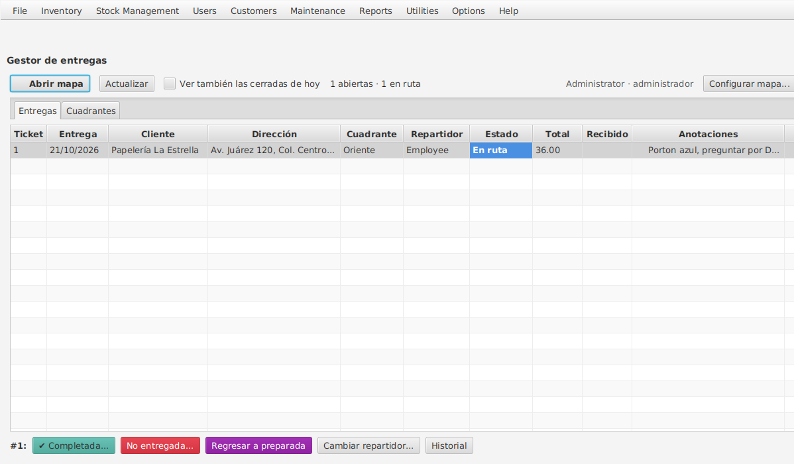

# Chromis POS 1.5.4 — mejoras

Mejoras sobre **Chromis POS y Chromis Admin 1.5.4 (232306)** sin recompilar
todo el programa: solo se reemplazan, dentro de `chromispos.jar` y `admin.jar`
originales, las clases que se modificaron.

## Estructura

| Carpeta | Contenido |
|---|---|
| `original/` | Archivos instalados de Chromis POS 1.5.4, **sin modificar**. |
| `original-admin/` | `admin.jar` de Chromis Admin 1.5.4, **sin modificar**. |
| `original-createdb/` | `dbcreator.jar` 1.5.4 (crea la base; solo se usó para pruebas). |
| `src/` | Clases modificadas o nuevas de Chromis POS. |
| `src-admin/` | Clases y pantallas (FXML) modificadas o nuevas de Chromis Admin. |
| `src-common/` | Código que va en ambos: respaldos, precio sobre costo, umbrales de reposición, pedido tentativo y entregas. |
| `tools/PatchJar.java` | Genera cada jar final: copia el original y reemplaza solo lo compilado. |
| `tools/javafx-11.0.2/` | JavaFX, solo para compilar Admin (en ejecución se usa el del JRE instalado). |
| `tests/` | Pruebas manuales contra MySQL/MariaDB (no van dentro del jar). |
| `dist/` | Resultado de la compilación (no se versiona). |

## Mejoras incluidas

1. **Lector de códigos de barras**: se ignoran los caracteres invisibles que
   envían algunos lectores (p. ej. Kuiiyer E308) y los programas que simulan
   teclado. El lector puede usarse en modo teclado normal, sin Scanpal2 ni
   scripts de AutoHotkey.
2. **Precios por niveles**: las líneas se pueden editar. Si solo cambia la
   cantidad, el precio se recalcula al nivel correspondiente; si se cambia el
   precio, se respeta.
3. **Productos auxiliares**: aparecen en el catálogo como cualquier producto y
   ya no se descartan si no hay una línea seleccionada. Solo se cuelgan debajo
   de un producto (y se borran junto con él) si en Admin están dados de alta
   como auxiliares de **ese** producto; cualquier otro auxiliar es una línea
   independiente. Antes, al borrar un producto se borraban todos los
   auxiliares que tuviera debajo aunque no tuvieran relación.
4. **Precio sobre costo por cliente**: ciertos clientes pagan *costo + margen %*.
   Tiene prioridad sobre niveles y descuentos. Si un producto no tiene costo,
   se avisa y no se permite venderlo a ese cliente.
   - Admin → Clientes, pestaña general: interruptor **Precio sobre costo** y
     **Margen sobre costo %**.
   - Admin → Productos, primera pestaña: interruptor **Precio sobre costo**
     (encendido por omisión; apagado = ese producto conserva su precio normal).
5. **Respaldos periódicos**: la terminal designada respalda la base completa
   (tablas, vistas, triggers, procedimientos y eventos) en un `.zip` dentro de
   una **carpeta local**, conserva los N más recientes y avisa al cajero si
   falla. No requiere `mysqldump`.
   - **Copiar también a** (opcional, p. ej. Google Drive): cada respaldo se
     copia a esa carpeta. Si Drive no está abierto o no está disponible, el
     respaldo local se hace igual y la copia queda **pendiente**; en cada
     revisión (cada minuto) se copian los que falten. La caja avisa una sola
     vez si la copia lleva más de 24 horas atrasada.
   - Admin → Utilidades → **Respaldos programados**: configuración, estado del
     último respaldo y de la copia a Drive, *Pedir respaldo ahora a la
     terminal* y *Respaldar ahora desde esta PC*. Usa el mismo permiso que el
     respaldo manual de Admin.
6. **Reposición** (lo que hacía el monitor *Lite* de sucursales):
   - Cada producto con *Controlar stock* tiene **mínimo, reserva y máximo**.
     Estados: *Agotado* (≤ 0), *Bajo* (≤ mínimo), *Reserva* (≤ reserva),
     *Normal*. Mínimo y máximo son los niveles de stock propios de Chromis (la
     pestaña *Stock Levels* del producto los muestra); la reserva se guarda aparte.
   - Admin → Stock Management → **Reposición**: tabla con el estado de cada
     producto, filtros y búsqueda. Los umbrales se escriben directo en la tabla.
     *Pedir* = máximo − stock y se puede cambiar. **Generar PDF de pedido**
     crea el pedido de los productos marcados, con el nombre de la empresa, la
     fecha, el usuario y espacio para la firma. Usa el permiso de *Orders*.
   - En la caja, al cobrar, un aviso en la esquina indica qué productos
     **entraron en reserva, quedaron bajo el mínimo o se agotaron**. También
     resume al abrir la caja cuántos productos están agotados o bajos. El aviso
     no quita el foco (el lector sigue escribiendo en el ticket), se cierra solo
     y se quita con un clic. Se activa o desactiva en la misma pantalla de Admin.
   - Corrección en Admin → Productos: al guardar un producto con niveles de
     stock, Chromis volvía a escribir el stock que tenía cuando se abrió el
     producto; las ventas hechas mientras estaba abierto se perdían del
     inventario. Ahora el stock no se toca al guardar.
7. **Inicio de sesión de Admin**: el usuario se elige de una lista con los
   usuarios registrados (visibles) y el cursor pasa directo a la contraseña.
   Recuerda el último usuario que entró en esa PC. Se puede seguir escribiendo
   un nombre o pasando una tarjeta, como antes. Si la contraseña es incorrecta,
   el usuario se conserva y solo se borra la contraseña.
8. **Existencias en los botones del catálogo**: debajo del nombre se muestra
   "Stock: 15" (productos con *Controlar stock*). Se activa y se elige el color
   en Admin → Stock Management → Reposición. Se actualiza tras cada venta y al
   cambiar de categoría (así también se ven las ventas de la otra caja).
9. **Conteos programados** (Admin → Stock Management → Conteos programados,
   permiso de *Stock Taking*): toma de stock por lotes en lugar de todo el
   inventario.
   - Un conteo tiene nombre, fecha y productos, que se agregan escaneando o con
     *Buscar y marcar...*.
   - **Conteo rotativo automático**: cada N días se crea solo un conteo con los
     N productos que nunca se han contado o llevan más tiempo sin contarse.
   - El conteo se captura escaneando (suma 1 o la cantidad indicada) o
     escribiendo en la tabla. Para cada producto se guarda el stock que tenía el
     sistema al contarlo, así que se puede contar con la tienda abierta.
   - Informes de Jasper solo con esos productos: **Hoja de conteo** (para
     imprimir y anotar), **Resultado / diferencias** (sistema, contado,
     diferencia y su valor a costo) y **Otro informe (.jrxml)**, que recibe
     `PLAN_ID` y `PRODUCT_IDS` (ver `docs/informes/ejemplo_informe_propio.jrxml`).
   - **Cerrar y ajustar stock**: lo contado queda como stock (respetando las
     ventas hechas después de contar) y cada ajuste queda en el diario de stock
     como "Conteo #N". Lo no contado no se toca. No usa el cierre de periodo
     de *Stock Taking* de Chromis, que pone todo el stock en cero.
10. **Códigos automáticos para control interno** en Admin → Productos. El
    botón **Generar código ▾** junto al PLU abre un menú:
    - **Code 128 con el nombre**: consonantes y números de la descripción del
      ticket (o de la referencia), **8 caracteres como máximo** por omisión
      (se puede cambiar de 4 a 12 en *Largo máximo del Code 128*). Ej.:
      "ASERRIN BOLSA NEGRO" → `SRRNBLSN`, "BOLSA 5KG" → `BLS5KG`, "CEMENTO GRIS
      PORTLAND 50 KG" → `CMNTGRSP`. Quita acentos (Ñ cuenta como N); si otro
      producto ya tiene ese código termina en 2, 3...
    - **EAN-13 interno**: `20` + consecutivo de 10 dígitos + dígito
      verificador (`2000000000015`, `2000000000022`...). El prefijo 20 está
      reservado por GS1 para uso dentro de la tienda, así que nunca coincide
      con un producto de fábrica. Chromis lo guarda como `EAN-13` y cualquier
      lector o impresora de etiquetas lo maneja.
    - **Al guardar sin código**: se elige cuál de los dos se genera solo si se
      guarda un producto con el PLU vacío (Code 128 por omisión).
    - Si el producto ya tiene código, pregunta antes de reemplazarlo.
    - La configuración es la misma para todas las PC de Admin (`pos_settings`:
      `product.code.type`, `product.code.maxlength`). Los códigos que ya
      existen no cambian.
11. **Asistencia automática** (Admin → Users → Asistencia automática). Cada
    opción se activa por separado:
    - **Entrada (check in)** al entrar a Chromis POS, solo si pasaron al menos
      N horas (6 por omisión) desde su última salida; volver a entrar el mismo
      turno no abre otra entrada.
    - **Salida (check out)** al hacer el corte de caja (la de quien lo hace;
      también cierra un descanso abierto).
    - Usa el registro propio de Chromis (`shifts`), así que la pantalla
      *Check In/Out* y sus reportes siguen funcionando y se puede marcar a mano.
    - Si alguien quedó con la entrada abierta de un día anterior (sin corte),
      al entrar de nuevo esa entrada se cierra a la hora de su última venta de
      ese día y se abre la de hoy.
    - La caja muestra un aviso "Entrada registrada" / "Salida registrada".
    - La pantalla de Admin muestra los últimos registros con las horas.
12. **Pedido con código de barras y recepción de mercancía** (Admin → Stock
    Management):
    - **Reposición → Generar PDF de pedido** ahora guarda el pedido en las
      tablas de pedidos de Chromis (`supplierorders`) y el PDF lleva el folio
      (`PED-000123`) en **Code 128**. El código solo lleva el folio; los
      productos, cantidades y costos se leen de la base al escanearlo, así que
      no importa si son 5 o 500 productos.
    - Se elige el proveedor; si no hay ninguno registrado se usa
      **Proveedor general**, que se crea solo.
    - Columna **En camino**: lo pedido que no ha llegado se resta de lo
      sugerido, para no pedirlo dos veces.
    - **Recepción de mercancía** (permiso de *Orders*): se escanea el folio del
      PDF (o se elige de la lista de pendientes) y aparece lo que debe llegar.
      - **✔ Llegó todo correcto**: un clic y entra todo al stock.
      - Si hay diferencias: se escribe lo recibido y el costo de factura por
        producto, o se escanea pieza por pieza (al escanear el primero, lo
        recibido empieza en 0 y cada lectura suma). Los productos que no venían
        en el pedido se agregan al escanearlos. Faltantes en rojo, sobrantes en
        azul, cambios de costo en amarillo.
      - Al confirmar entra al stock solo lo recibido (diario de stock motivo 9,
        "Pedido PED-000123", como la recepción de Chromis) y se genera el
        **contrarecibo** en PDF (pedido, recibido, diferencia, costos,
        importes, totales y firmas de quien entrega y quien recibe).
      - **Faltantes**: quedan registrados y aparecen en Reposición en la
        columna *Faltó (ped. ant.)*, marcados para el siguiente pedido; en el
        PDF del siguiente pedido se anota "Incluye N que faltaron en
        PED-000123".
      - **Costos**: la recepción **no cambia el costo** del producto (la de
        Chromis sí). Un costo distinto queda **por autorizar**.
      - **Reimprimir pedido** y **Reimprimir contrarecibo**.
    - **Autorizar costos** (permiso de *Products*): lista de cambios de costo
      con costo actual y nuevo, variación en % y precio de venta sugerido que
      conserva el margen (editable). Al autorizar se cambia el costo y, si está
      marcado *Cambiar venta*, el precio de venta; también se puede rechazar.
      Queda registrado quién y cuándo lo decidió.
    - Los pedidos se ven también en la pantalla *Orders* original de Chromis.
13. **Pedido tentativo diario** (versión *Enterprise*; Admin → Stock Management
    → **Pedido tentativo**, permiso de *Orders*):
    - Todos los días a las **16:30** (se cambia en la misma pantalla) se arma
      solo un borrador de pedido **por proveedor** con lo que necesita surtirse:
      productos agotados, bajos o en reserva y lo que faltó en pedidos
      anteriores, con las mismas cantidades que propone Reposición (máximo −
      stock − en camino, o al menos lo que faltó). No depende del corte de caja.
    - Lo arma la primera caja abierta (o la que se indique). Si a esa hora no
      había ninguna encendida, se arma en cuanto se abre una. Si dos cajas
      revisan al mismo tiempo, solo una lo arma.
    - Proveedor de cada producto: el registrado en Admin → Productos →
      Suppliers (si hay varios, al que se le pidió la última vez); si no tiene,
      al que se le pidió la última vez; si nunca se pidió, **Proveedor general**.
    - **Nunca se envía solo.** En la caja aparece el aviso *Pedido tentativo
      listo* (una vez a cada usuario con permiso de *Orders*). En Admin se
      revisa cada borrador: cambiar cantidades, quitar productos, agregar
      escaneando o escribiendo el código, o descartarlo.
    - **Enviar pedido...** pide confirmación con el resumen (productos,
      unidades, costo estimado y, si alguno ya tiene pedido en camino, cuáles)
      y entonces lo guarda como pedido normal de Chromis con su folio y su PDF,
      igual que *Reposición → Generar PDF de pedido*. Se recibe en *Recepción de
      mercancía*. Queda registrado quién lo envió o descartó y cuándo.
    - Un borrador sin revisar se reemplaza por el del día siguiente.
14. **Mostrador o Entrega** (versión *Enterprise*):
    - En la barra del ticket hay un botón que dice **MOSTRADOR** o **ENTREGA**.
      Al tocarlo se elige el tipo de pedido; para una entrega se muestran los
      datos de entrega **ya llenos con los del cliente** (recibe, dirección,
      colonia, ciudad, C.P., teléfono), la fecha de entrega (hoy por omisión) y
      las indicaciones para el repartidor. Una entrega necesita un cliente
      asignado.
    - Al cobrar a un cliente sin haber marcado nada, la caja pregunta (con
      Mostrador preseleccionado). Sin cliente es venta de mostrador y no
      pregunta. Se puede apagar la pregunta o el botón en Admin → Customers →
      **Entregas**.
    - Usa la entrega propia de Chromis: se guarda en `customer_delivery` (con el
      mismo id que el ticket) y el ticket impreso lleva el bloque de entrega
      (`Printer.Delivery`). El cargo de envío de Chromis (producto
      *Delivery-Charge*) sigue funcionando y también deja el ticket como entrega.
      Además el ticket guarda `tipo_pedido` (`mostrador` / `entrega`) y los
      datos de entrega en sus propiedades, así que una venta en espera los
      conserva.
    - Corrección: en Chromis original los datos de entrega se quedaban en la
      pantalla después de cobrar, y la siguiente venta también se guardaba e
      imprimía como entrega. Ahora pertenecen al ticket activo.
    - Admin → Customers → **Entregas**: entregas pendientes (ticket, fecha de
      venta y de entrega, cliente, quién recibe, dirección, teléfono,
      indicaciones y total) para marcarlas como entregadas; también se ven las
      entregadas de los últimos 7 días.

15. **Gestor de entregas: datos e importación** (versión *Enterprise*; la
    pantalla y el mapa están en la mejora 16, *Mis entregas* en Android viene
    después):
    - **Ubicación de cada cliente** (`customer_geo`): latitud y longitud, estado
      comercial (*prospecto*, *cautivo*, *pendiente de visita*) y quién puso el
      pin (web, Admin o app). No se aceptan coordenadas 0, 0 ni fuera de rango.
    - **Cuadrantes** (`delivery_zones`): polígono, color, despachador a cargo y
      repartidor. La entrega toma el cuadrante donde cae la ubicación de su
      cliente; a una entrega se le puede poner otro repartidor solo a ella. Los
      cuadrantes no se borran, se desactivan.
    - **Estados de la entrega** (`delivery_status`): confirmado → preparado →
      en ruta → completado / no entregado, o cancelado. La oficina (admin o el
      despachador del cuadrante) prepara, da salida, reprograma o cancela; el
      repartidor solo cierra **sus** entregas en ruta; solo el admin reabre una
      completada. Al completar se exige el **monto recibido** (0 si no se
      cobró); *no entregado* exige el motivo; una incidencia (faltante,
      rechazo, dañado, otro) exige anotación. Completar marca la entrega como
      entregada en Chromis y reabrirla la desmarca; una marcada a mano en
      Admin → Entregas cuenta como completada.
    - **Nada a medias**: cada cambio se aplica en una transacción con la venta
      y su estado bloqueados; si algo falla no cambia nada. Cada cambio trae
      un identificador creado por quien lo envía (`delivery_events.op_id`,
      único): si el celular lo reenvía porque se cortó la señal, no se aplica
      dos veces. El historial (`delivery_events`) guarda quién, cuándo, de qué
      estado a cuál, monto e incidencia.
    - **Importar clientes de la web**: Admin → Customers → Entregas →
      *Importar clientes de la web (CSV)*. Se exporta la tabla `clientes` de
      Supabase como CSV y se elige el archivo; primero muestra cuántos se
      crearán, enlazarán u omitirán y pide confirmar. Cada cliente de la web
      queda con número de cuenta `WEB-<id_cliente>`, así que volver a importar
      el archivo no duplica; si en Chromis ya hay un cliente con el mismo
      nombre se enlaza a ese (si hay dos, se omite para ubicarlo a mano). Un
      pin movido después en Chromis no se sobrescribe. Todo el archivo entra en
      una sola transacción.

16. **Gestor de entregas: pantalla y mapa** (versión *Enterprise*, Admin →
    Customers → **Gestor de entregas**):
    - **Entregas**: las abiertas (y, si se marca, las cerradas hoy) con
      cuadrante, repartidor, estado en color, total, monto recibido y
      anotaciones. Al elegir una aparecen solo los botones que su estado y el
      papel del usuario permiten: *Preparada*, *Salió a ruta*, *Completada...*,
      *No entregada...*, *Reprogramar*, *Cancelar entrega*, *Reabrir* (solo el
      administrador), *Cambiar repartidor...* (solo para esa entrega) e
      *Historial* (quién, cuándo, de qué estado a cuál, monto e incidencia).
    - *Completada* y *No entregada* abren el formulario rápido: monto recibido
      (prellenado con el total), incidencia (faltó mercancía, rechazó, dañada,
      otra) y anotaciones. No deja guardar sin monto, sin el motivo de no
      entrega o con incidencia sin anotación. Mientras el repartidor no tenga
      *Mis entregas* en el celular, la oficina captura aquí lo que reporta.
    - **Cuadrantes**: repartidor y despachador de cada uno (despachador vacío =
      cualquiera). El administrador asigna ambos; el despachador de un
      cuadrante puede cambiar su repartidor.
    - **Papeles**: es *administrador* quien puede editar roles (permiso
      *UserRoles*); los demás usuarios con acceso a Customers son
      *despachadores*. Un despachador no mueve entregas de cuadrantes de otro
      despachador.
    - **Mapa** (*Abrir mapa*): se abre en el navegador de la PC (Chrome,
      Vivaldi...), donde Google Maps funciona completo, en lugar de dentro de
      Admin. Muestra las entregas con su color de estado y número de ticket,
      los cuadrantes y los clientes ubicados (cliente, prospecto o pendiente de
      visita). El administrador **dibuja** un cuadrante haciendo clic en sus
      esquinas y lo **edita** arrastrándolas; cualquiera de la oficina
      **ubica o mueve** el pin de un cliente (clic en el mapa o buscando la
      dirección). La pestaña *Clientes* lista primero los que no tienen
      ubicación. Lo que se guarda en el mapa aparece solo en Admin.
    - **Seguridad del mapa**: lo atiende el propio Admin solo en esa PC
      (`127.0.0.1`, puerto 47123 por omisión), con una clave nueva en cada
      apertura; sin ella, o si la petición no va dirigida a 127.0.0.1 /
      localhost (otra página web), no responde. No se puede entrar desde la
      red.
    - **Configurar mapa...** (administrador): clave de Google Maps, centro del
      mapa y puerto. La clave necesita *Maps JavaScript API* y *Geocoding API*
      y se restringe a sitios web `http://127.0.0.1:47123/*`.

    - **Repartidor:** confirma desde Chromis Android → *Mis entregas* (rol con
      el permiso "Mis entregas (repartidor)"; ver el README de
      `chromis-android`). Sin señal la confirmación se queda en el celular y
      llega después, una sola vez. Lo que confirma aparece aquí con el monto
      recibido y las anotaciones.

    

### Tablas nuevas

Se crean solas la primera vez; **la estructura de las tablas originales de
Chromis no cambia**, por lo que volver al jar original no causa problemas
(los mínimos y máximos de reposición se guardan en la tabla original
`stocklevel` y el jar original también los entiende).

| Tabla | Uso |
|---|---|
| `costpricing_customers (customer, markup)` | Margen sobre costo (%) por cliente. |
| `costpricing_excluded (product)` | Productos que conservan su precio normal. |
| `backup_settings` | Configuración y estado de los respaldos (una fila, `id = 1`). |
| `restock_reserve (location, product, reserve)` | Nivel de reserva por producto. |
| `restock_settings` | Avisos en caja activados y aviso de reserva (una fila, `id = 1`). |
| `pos_settings (name, value)` | Otros ajustes: existencias en botones (`catalog.stock.show`, `catalog.stock.color`), conteo rotativo (`stockcount.rotation.*`), asistencia (`attendance.*`) y códigos automáticos (`product.code.*`). |
| `stockcount_plans`, `stockcount_lines` | Conteos programados y lo contado de cada producto. |
| `order_carryover` | Faltantes de cada pedido recibido y el pedido al que pasaron. |
| `price_changes` | Cambios de costo encontrados al recibir: pendientes, autorizados o rechazados. |
| *(ninguna para entregas)* | Las entregas usan la tabla original `customer_delivery`; el botón y la pregunta al cobrar van en `pos_settings` (`delivery.button`, `delivery.ask`). |
| `customer_geo` | Ubicación y estado comercial de cada cliente. |
| `delivery_zones` | Cuadrantes: polígono (`lat,lng;lat,lng;...`), color, despachador y repartidor (`people.id`). |
| *(pos_settings)* | Mapa de entregas: `maps.apikey`, `maps.center`, `maps.port`. |
| `delivery_status`, `delivery_events` | Estado actual de cada entrega (mismo id que el ticket) y su historial con el identificador único de cada operación. |
| `restock_drafts`, `restock_draft_lines` | Pedidos tentativos por proveedor y sus productos: borrador, enviado (con su folio), descartado o reemplazado. Su hora, caja y último resultado van en `pos_settings` (`restock.draft.*`). |

Se configuran desde Admin; si hiciera falta, también con SQL, por ejemplo:

```sql
-- Cliente con 7.5 % sobre costo (id del cliente de la tabla customers)
INSERT INTO costpricing_customers (customer, markup) VALUES ('<id-cliente>', 7.5);

-- Respaldos cada 24 h desde la terminal CAJA1, conservando 30, con copia a Drive
UPDATE backup_settings
   SET enabled = 1, terminal = 'CAJA1', folder = 'C:\\Respaldos Chromis',
       copy_folder = 'G:\\Mi unidad\\Respaldos Chromis',
       interval_hours = 24, keep_count = 30
 WHERE id = 1;
-- Respaldar ahora
UPDATE backup_settings SET run_now = 1 WHERE id = 1;
```

El nombre de la terminal es el que Chromis usa como `terminalID`.

## Pruebas realizadas

Con una base creada por el `dbcreator.jar` 1.5.4 (en `original-createdb/`) sobre
MariaDB, se ejecutaron Chromis POS y Chromis Admin modificados (capturas en
`docs/capturas/`):

| Prueba | Resultado |
|---|---|
| Código con caracteres invisibles delante (STX, GS, ancho cero, uso privado) | Original: *"❈7500000000024 - This Product Code does not exist"*. Mejorado: agrega el producto. |
| Editar línea de producto con niveles (10 pzas → $25) | Original: botón de editar desactivado. Mejorado: cantidad 12 → $25 c/u; precio manual $27 se respeta. |
| Auxiliar en catálogo y con ticket vacío | Original: no aparece y escanearlo con ticket vacío no agrega nada. Mejorado: aparece y se agrega. |
| Cliente con 7.5 % sobre costo | Arroz $30 (costo $20) → $21.50; producto excluido conserva $80; producto sin costo muestra aviso y no se agrega; al quitar el cliente vuelve a $30. |
| Captura en Admin | Margen del cliente y opción del producto se guardan y se vuelven a mostrar al reabrir. |
| Copia a Drive | Con la carpeta de copia inexistente (como G: sin Google Drive) el respaldo local salió correcto y la copia quedó *pendiente*; al crear la carpeta, la siguiente revisión copió el respaldo; con 3 respaldos y "conservar 2" ambas carpetas quedaron con los mismos 2; con la copia atrasada más de 24 h la caja avisó una sola vez en 3 revisiones; al volver la carpeta se puso al día. La tabla existente recibió las columnas nuevas sin perder su configuración. |
| Restaurar respaldo | `tests/RestoreToolTest.java` con solo `restaurar.jar` (sin Chromis ni `mysql.exe`): el `.zip` de un respaldo programado se reconoce completo y uno cortado a la mitad no; la base restaurada tiene las mismas 112 tablas, 35 triggers, vista, rutina, productos, tickets, clientes, existencias y versión que la original, y los triggers de Chromis siguen activos; la contraseña cifrada de `chromisposconfig.properties` se lee. En la ventana: con otra conexión abierta en la base la mostró, la cerró, pidió confirmar el borrado y restauró. |
| Respaldo programado | La caja designada respaldó al abrir ventas y al pedirlo desde Admin; la restauración tiene las mismas tablas, vista, 35 triggers y rutina, con checksums iguales. |
| Reposición en Admin | Umbrales escritos en la tabla se guardan en `stocklevel`/`restock_reserve` y se ven en *Stock Levels* del producto; reserva menor que el mínimo se rechaza con mensaje; PDF con 2 productos y cantidad editada a mano. |
| Avisos en caja | Al abrir: "1 producto bajo el mínimo". Ventas de Arroz (mín. 5, reserva 10): 12 → 9 *En reserva*, 9 → 4 *Bajo el mínimo*, 4 → 3 sin aviso, 3 → 0 *Se agotó*. El lector siguió funcionando con el aviso en pantalla. |
| Borrar producto con auxiliar debajo | Original: al borrar Arroz se borraba también la Espiral (auxiliar sin relación). Mejorado: la Espiral se queda; la Bolsa (auxiliar de Arroz en Admin) sí se borra con él. |
| Existencias en botones | "Stock: 20" en Espiral; tras vender 2 pasa a "Stock: 18" sin reiniciar; cambio de color y apagado desde Admin se ven al cambiar de categoría. Agregar 10 productos al ticket: antes 946 consultas a la base (el catálogo se reconstruía en cada producto agregado, lo que hacía lenta la caja), ahora 43 sin reconstruir el catálogo. |
| Conteos programados | Conteo de 3 productos: Arroz escaneado 3 veces (sistema 11), Bolsa 5 (sistema 3), Espiral 18 en la tabla; hoja, resultado (−$160 / +$2) e informe propio solo con esos 3; tras vender 2 Arroz después de contar, al cerrar Arroz queda en 1 (9 − 8) y Bolsa en 5, con movimientos "Conteo #5" en el diario. Rotativo de 2 productos toma los nunca contados y programa el siguiente a 7 días. |
| Código Code 128 | Botón: "ASERRIN BOLSA NEGRO" → SRRNBLSNGR, guardado como CODE128 y encontrado al escanearlo en la caja; en Arroz (EAN-13) pregunta antes de reemplazar. Guardando sin código: "CEMENTO GRIS PORTLAND 50 KG" → CMNTGRSPRTLN. |
| Código corto y EAN-13 interno | Cemento: Code 128 con largo 8 → CMNTGRSP, con largo 6 → CMNTGR; EAN-13 interno → 2000000000015, guardado por Chromis como `EAN-13`; con "al guardar sin código: EAN-13" y el PLU vacío se generó solo. |
| Asistencia automática | Con ambas opciones activas: al abrir la caja se registró la entrada (aviso verde); al hacer el corte, la salida (aviso azul); al volver a entrar un minuto después no se abrió otra. Pruebas con horas simuladas: apagado no registra, 2 h después del corte no abre, al día siguiente sí, entrada olvidada de ayer se cierra a la hora de su última venta. |
| Pedido y recepción | Reposición con Bolsa (17) y Espiral (4, faltante de un pedido anterior) → PED-000006 con su código; el código del PDF se lee como Code 128 "PED-000006". Escaneando el folio se cargó el pedido; se escanearon 15 bolsas, 2 Arroz (no pedidos) y nada de Espiral, costo de bolsa 1.20 y factura F-778: stock Bolsa 3 → 18, Arroz 11 → 13, costo de bolsa sin cambio, contrarecibo con faltantes. En Reposición: Bolsa 2 y Espiral 4 marcados como faltantes. *Autorizar costos*: Bolsa 1.00 → 1.20 (+20 %), venta sugerida 2.40 cambiada a 2.50 y autorizada. Otro pedido con *Llegó todo correcto*: Espiral 18 → 22. Los pedidos aparecen en *Orders* de Chromis. |
| Inicio de sesión en Admin | La lista muestra Administrator, Employee y Manager; al elegir Manager el cursor pasa a la contraseña; contraseña incorrecta se rechaza; la correcta entra; al volver a abrir Admin, Manager ya está seleccionado. |
| Guardar producto en Admin con ventas de por medio | Original: el stock regresó de 7 a 11 (se perdió la venta). Mejorado: se conserva. |
| Mostrador / Entrega | En Chromis POS: cliente asignado escaneando su tarjeta, botón → Entrega con los datos llenos desde el cliente y una indicación; al cobrar se guardó en `customer_delivery` (ticket 1) y en las propiedades del ticket, y el ticket siguiente volvió a Mostrador. Venta al mismo cliente sin marcar: preguntó al cobrar y quedó como mostrador sin entrega. Venta sin cliente: no preguntó. Entrega sin cliente: pide asignarlo. Con el botón apagado en Admin no aparece. En Admin → Entregas se vio la entrega y se marcó como entregada. `tests/DeliveryTest.java` (19 comprobaciones). |
| Gestor de entregas (datos) | `tests/DeliveryManagerTest.java` (76 comprobaciones): coordenadas válidas e inválidas, polígono en L, cuadrante por la ubicación del cliente, permisos por papel (el repartidor no prepara ni toca entregas ajenas, otro despachador no mueve las de un cuadrante ajeno), monto y motivo obligatorios sin dejar nada a medias, la misma operación reenviada y enviada **al mismo tiempo desde dos conexiones** se aplica una sola vez, dos cierres distintos simultáneos: uno gana y el otro se rechaza; importación con comillas, comas, saltos de línea y BOM, vista previa sin guardar, enlace por nombre, nombres repetidos omitidos, reimportación sin duplicar y pin movido respetado. |
| Gestor de entregas (pantalla y mapa) | En Chromis Admin: la entrega de la Estrella dentro del cuadrante *Oriente* (repartidor Employee) pasó a *Preparada*, *En ruta* y *Completada* con el formulario ($36 recibido), se reabrió (con confirmación) y al intentar *No entregada* sin motivo no dejó guardar; historial con los 4 cambios; despachador Manager asignado al cuadrante. El mapa abierto desde Admin guardó un cuadrante nuevo y Admin lo mostró solo. `tests/MapServerTest.java` (39 comprobaciones): sin la clave o dirigido a otra dirección no responde, no se alcanza desde la red, el despachador no dibuja cuadrantes pero sí ubica clientes, coordenadas 0,0 o sin coordenadas se rechazan sin borrar la ubicación, otra sesión invalida la clave anterior, el cuadrante cambia de forma y las entregas fuera de él salen. `tests/mapa_navegador.py` (Chromium con Google Maps simulado): dibujar, nombrar y editar cuadrantes, buscar y mover el pin de un cliente. |
| Pedido tentativo | `tests/DraftOrderTest.java` (54 comprobaciones): horario (antes y después de la hora, caja apagada a la hora, caja designada, apagado), cantidades (bajo, agotado, reserva con pedido en camino, faltante), proveedor por producto, reemplazo, edición, descartar y enviar. Con Chromis POS abierto y la hora ya pasada, la caja armó los borradores al minuto y mostró *Pedido tentativo listo*; en Admin se cambió una cantidad, se quitó un producto, se agregó otro escaneando y se envió como PED-000009 con su PDF. |

El botón de editar línea solo aparece a usuarios con el permiso
`button.lineeditor` (comportamiento original de Chromis; se asigna en Admin →
Roles).

## Compilar

Requiere **JDK 11 o superior** (no basta el JRE).

- Windows: `build.bat`
- Linux/macOS: `./build.sh`

El resultado queda en `dist\chromispos.jar` y `dist\admin.jar`.

## Instalar

Igual para cada programa (`chromispos.jar` en las cajas, `admin.jar` donde se
use Chromis Admin):

1. Cerrar el programa.
2. En la carpeta de instalación, **renombrar** el jar a `*.jar.original`
   (es el respaldo para volver atrás).
3. Copiar ahí el jar nuevo de `dist\`.
4. Abrir el programa y probar.

Para volver atrás: cerrar el programa, borrar el jar nuevo y quitar
`.original` al nombre del respaldo.

Se recomienda probar primero en **una sola terminal** antes de copiarlo a las demás.

## Restaurar un respaldo

Con **`restaurar.jar`** (en `dist/` y en la rama `descargas`): copiarlo a la
carpeta de instalación de Chromis y abrirlo con doble clic, como el
`dbcreator.jar`. Toma el servidor, el usuario, la contraseña y la base de
`chromisposconfig.properties` de esa carpeta (se pueden cambiar, por ejemplo
para restaurar en una base con otro nombre y revisarla antes).

1. Elegir el respaldo: el `.zip` de los respaldos programados (no hace falta
   descomprimirlo) o un `.sql`.
2. **Restaurar**. Primero lee el archivo completo y, si no termina como un
   respaldo de Chromis (cortado, o de otro programa), pregunta antes de
   borrar nada.
3. Si hay programas con la base abierta (Chromis POS, Admin, el monitor,
   HeidiSQL...), los muestra con su equipo y ofrece cerrar esas conexiones;
   nunca se queda esperando más de 20 segundos.
4. Pide confirmar que se borre la base, la crea de nuevo y carga el respaldo
   con el avance real (se puede cancelar; la base queda incompleta y hay que
   restaurar otra vez).
5. Al final revisa la base: tablas y versión de Chromis.

No necesita `mysql.exe`. El restaurador del `dbcreator.jar` original puede
quedarse en "Restoring database" para siempre: le pasa el archivo a
`mysql.exe` sin leer lo que este escribe, lee el respaldo entero a memoria y
borra la base sin límite de espera (si Chromis la tiene abierta, espera sin
fin).

También se puede con el cliente de MySQL (descomprimir antes el `.zip`):

```
mysql -u USUARIO -p NOMBRE_BASE < chromis-AAAAMMDD-HHMMSS.sql
```

Cualquiera de los dos **reemplaza** el contenido de esa base: hacerlo con
Chromis cerrado en todas las terminales.
